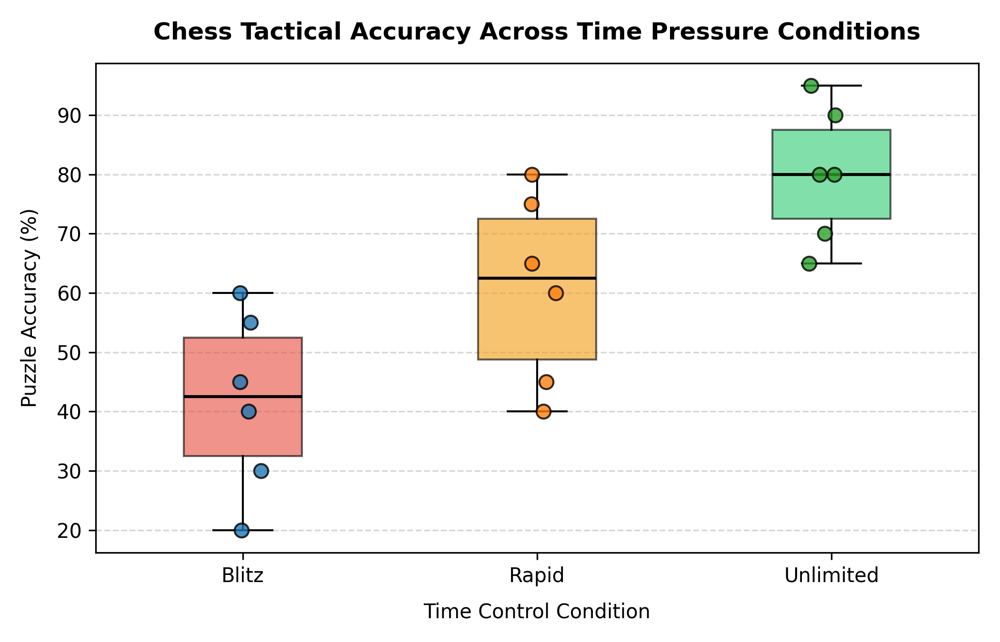
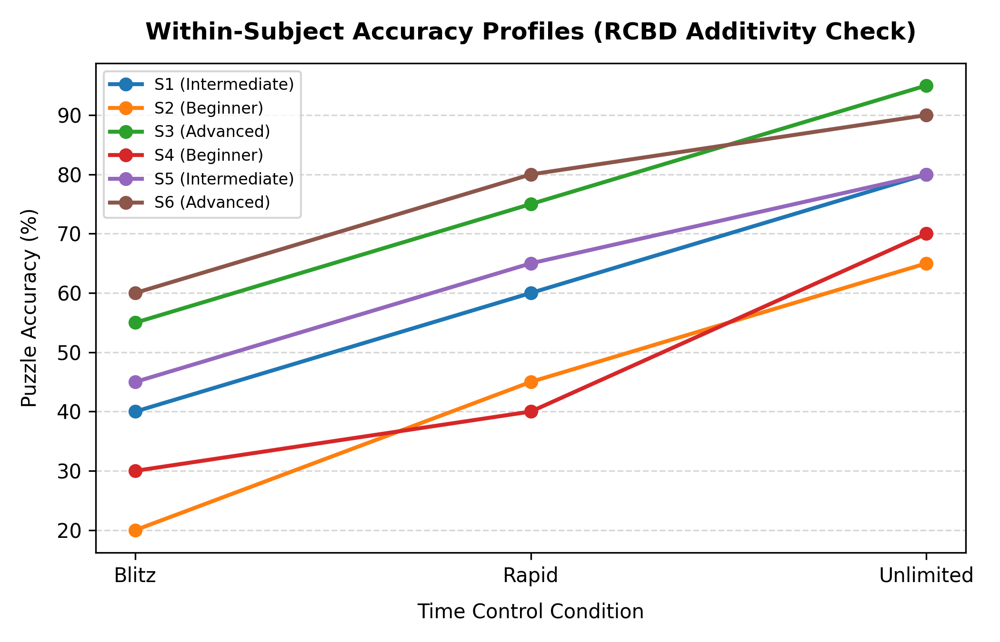

# ♟️ Time Pressure and Decision Quality in Chess Puzzle Solving

[](https://www.r-project.org/)
[](https://quarto.org/)
[](https://en.wikipedia.org/wiki/Randomized_block_design)

**Does tactical accuracy in chess decline gradually as time shrinks, or fall off a cliff?**
This project is a designed experiment (randomized complete block design with Latin square counterbalancing) in which 6 players solved Lichess puzzles under three time controls. Time pressure caused a large, consistent drop in accuracy, and the drop was about the same size for every player.

📄 **[Full report (PDF)](report.pdf)** · 📊 **[Raw data](chess_puzzle_data.csv)** · 🧪 **[Reproducible Quarto source](chess_decision_experiment.qmd)**

*By Sai Kadiyala*

---

## TL;DR

| Time control | Mean accuracy |
|---|:---:|
| Unlimited | **80.0%** |
| Rapid (30 s / puzzle) | **60.8%** |
| Blitz (5 s / puzzle) | **41.7%** |

- Time control had a very strong effect on accuracy: **F(2, 8) = 302.29, p < 0.001, partial η² = 0.987**.
- Each step down in time cost about **19 percentage points**: Unlimited → Rapid (−19.2 pp) and Rapid → Blitz (−19.2 pp). All Tukey HSD contrasts have p < 0.001.
- **No cliff was observed.** The two steps were equal in size. Because "Unlimited" has no numeric time limit, this is a statement about steps between conditions, not a fitted linear trend in seconds.
- **Effects were additive across players.** Subject profiles are parallel (Tukey's non-additivity test: p = 0.81), so players of different strength lost roughly the same number of points under pressure.

---

## Research Question

> How severely do strict time constraints degrade tactical decision quality in chess, and does performance decline smoothly or collapse when moving from rapid evaluation to speed heuristics?

---

## Experimental Design

I used a **Randomized Complete Block Design (RCBD)** with subjects as blocks, so every player is measured under every condition. Individual skill is therefore removed from the treatment comparison. A **replicated 3 × 3 Latin square** balances which condition appears in which period, so fatigue and learning effects do not get mixed up with the treatment.

| Group | Subjects | Period 1 | Period 2 | Period 3 |
|---|---|---|---|---|
| 1 | S1, S2 | Blitz | Rapid | Unlimited |
| 2 | S3, S4 | Rapid | Unlimited | Blitz |
| 3 | S5, S6 | Unlimited | Blitz | Rapid |

| Design element | Detail |
|---|---|
| Participants | 6 adult recreational-to-advanced players, recruited at Lake Balboa Park, Los Angeles |
| Puzzles | 90 tactical puzzles sampled at random from the Lichess puzzle database, restricted to a **1200–1400 rating band** |
| Each period | 10 puzzles under one time control |
| Observations | 18 (6 subjects × 3 conditions) |
| Response | Puzzle accuracy (% correct out of 10) |
| Power | A priori power of 0.82 at α = 0.05, from pilot data (σ ≈ 10%, detectable effect Δ = 20%) |

### Model

$$y_{ijk} = \mu + \tau_i + \beta_j + \gamma_k + \varepsilon_{ijk}, \qquad \varepsilon_{ijk} \overset{\text{iid}}{\sim} \mathcal{N}(0,\sigma^2)$$

| Term | Meaning |
|---|---|
| $\tau_i$ | Fixed effect of time control (Blitz, Rapid, Unlimited) |
| $\beta_j$ | Block effect of subject (j = 1…6) |
| $\gamma_k$ | Nuisance effect of period (k = 1…3), which absorbs fatigue and learning |
| $\varepsilon_{ijk}$ | Residual error |

---

## Results

<p align="center">
  
  
</p>

*Left: accuracy falls monotonically as time tightens. Right: every subject follows a parallel trajectory, which supports the additivity assumption.*

### ANOVA (Type I sequential sums of squares)

| Source | df | SS | MS | F | p |
|---|:---:|---:|---:|---:|:---:|
| **Time control** | 2 | 4408.33 | 2204.17 | **302.29** | **< 0.001** |
| Subject (block) | 5 | 2891.67 | 578.33 | 79.31 | < 0.001 |
| Period | 2 | 108.33 | 54.17 | 7.43 | 0.015 |
| Residuals | 8 | 58.33 | 7.29 | | |
| Total | 17 | 7466.67 | | | |

- **Effect size:** partial η² = SS<sub>time</sub> / (SS<sub>time</sub> + SS<sub>error</sub>) = 0.987.
- **Blocking paid off:** subjects account for about 38.7% of total variation. Without blocking, that variation would have been left in the error term.
- **Period effect (p = 0.015):** there is a modest order effect, which is the reason for the Latin square counterbalancing.

### Tukey HSD pairwise contrasts

| Contrast | Difference | SE | t | Adj. p |
|---|:---:|:---:|:---:|:---:|
| Unlimited − Rapid | +19.17 pp | 1.56 | 12.30 | < 0.001 |
| Rapid − Blitz | +19.17 pp | 1.56 | 12.30 | < 0.001 |
| Unlimited − Blitz | +38.33 pp | 1.56 | 24.60 | < 0.001 |

### Model diagnostics

| Assumption | Test | Result |
|---|---|---|
| Normal residuals | Shapiro-Wilk on studentized residuals | W = 0.958, p = 0.570 ✅ |
| Equal variances | Levene's test across conditions | F = 0.44, p = 0.651 ✅ |
| Additivity (no subject × treatment interaction) | Tukey's 1-df test | F = 0.06, p = 0.812 ✅ |

---

## Limitations

- **Small sample.** There are 6 players and 18 observations, which is enough for a large effect like this one but not for estimating subtle differences between skill levels.
- **Convenience sample.** Players were recruited at one park, so the results may not generalize to online or tournament players.
- **Narrow difficulty band.** All puzzles were rated 1200–1400, and stronger or weaker puzzle sets could behave differently.
- **Ordinal time scale.** "Unlimited" has no numeric time, so I cannot fit a true dose-response curve in seconds. A follow-up with more numeric time levels (e.g. 5, 10, 20, 40 s) would test linearity directly.
- **Carryover.** The cyclic Latin square balances periods but not first-order carryover between conditions.

---

## Repository Structure

```text
chess-time-pressure-rcbd/
├── README.md
├── report.pdf                      # Full formal write-up
├── chess_decision_experiment.qmd   # Quarto source: R code, analysis, LaTeX
├── data/
│   └── chess_puzzle_data.csv       # Raw trial data (subject, condition, period, score)
└── figures/
    ├── accuracy_by_condition.png
    └── subject_profiles.png
```

---

## Reproduce the Analysis

**Requirements:** R ≥ 4.2 and [Quarto](https://quarto.org/docs/get-started/). Rendering to PDF also needs a LaTeX install (e.g. `quarto install tinytex`).

```bash
git clone https://github.com/psailus/chess-time-pressure-rcbd.git
cd chess-time-pressure-rcbd
```

```r
install.packages(c("tidyverse", "emmeans", "car", "knitr", "kableExtra"))
```

```bash
quarto render chess_decision_experiment.qmd --to pdf
```

---

## Tools

R (`tidyverse`, `emmeans`, `car`) for analysis and plots · Quarto + LaTeX for the report · [Lichess puzzle database](https://database.lichess.org/#puzzles) for stimuli.

## Citation

```bibtex
@misc{kadiyala_chess_time_pressure,
  author = {Kadiyala, Sai},
  title  = {Time Pressure and Decision Quality in Chess Puzzle Solving},
  note   = {RCBD with replicated Latin square counterbalancing},
  year   = {2026}
}
```
